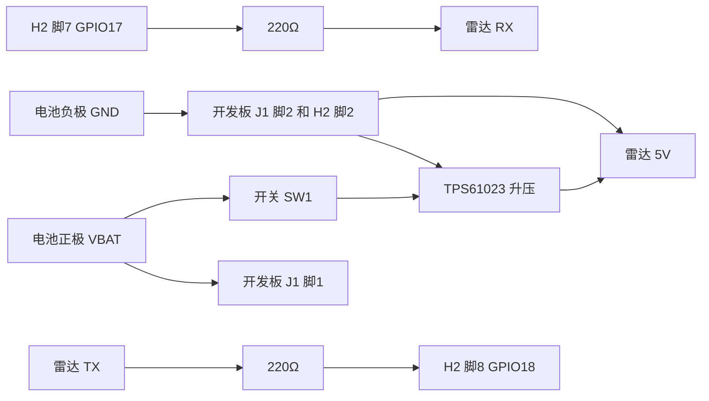

# eyeballer-seeker

手腕上的一块大圆屏，屏幕里是一张二次元脸。手平放在桌上时，眼睛跟着从旁边走过的人转，人走了就慢慢看回中间。这是「蒙娜丽莎效应」：你从侧面看，也会觉得眼睛在看你。戴着它的人自己不算目标。胳膊在动（走路、甩手）时，眼睛不要追人，只是随便看看、眨眨眼。

**这一版只有硬件接线。** 固件还没做，见 [`firmware/README.md`](firmware/README.md)。

手机上直接打开这张图（可以放大）：

[`hardware/schematic.png`](hardware/schematic.png)

同一张图的 PDF：[`hardware/schematic.pdf`](hardware/schematic.pdf)

转接板顶层、底层：[`hardware/pcb-top.png`](hardware/pcb-top.png)、[`hardware/pcb-bottom.png`](hardware/pcb-bottom.png)

模块怎么连，看这张框图：[`hardware/block-diagram.png`](hardware/block-diagram.png)

KiCad 工程：[`hardware/eyeballer-seeker.kicad_pro`](hardware/eyeballer-seeker.kicad_pro)（原理图和转接板。用 KiCad 7 或 8 打开。原理图是 KiCad 7 的格式。）旧版 Altium 打不开这些文件，看图用上面的 PDF 和 PNG。

第一次用 GitHub、只想下载或看图：[`docs/github-beginner.md`](docs/github-beginner.md)

## 这一版要做成什么样

人坐在咖啡馆或餐厅，手不动，表盘朝外。陌生人从侧面大约 0.5 到 3 米外走过。雷达看到人，眼睛锁住其中一个，直到人离开。

开发板是现成的，雷达也是现成的。自己要接的是：电池、一个只控制雷达的开关、一块 5V 升压模块、雷达。

请买 **不带 GPS 的版本**（标准版或带壳的 `-B`）。`-G` 版的 GPIO17 / GPIO18 可能已经接到板上的 GPS，这两脚本设计要给雷达串口用。

## 零件

价格是 2026 年 10 月公开页面上的大约数字，下单时以页面为准。

| 零件 | 作用 | 大约价格 | 链接 |
| --- | --- | --- | --- |
| Waveshare ESP32-S3-Touch-AMOLED-1.75 | 圆屏、ESP32-S3、电池充电、IMU。买标准版或 `-B`，不要 `-G` | 官网约 30–40 美元；国内店铺常见大约 180–250 元 | [官网](https://www.waveshare.com/esp32-s3-touch-amoled-1.75.htm) · [Wiki](https://www.waveshare.com/wiki/ESP32-S3-Touch-AMOLED-1.75) |
| HLK-LD2450 | 24 GHz 雷达。5V 供电，串口 3.3V，最多 3 个目标 | 大约 30–40 元 | [海凌科产品页](https://www.hlktech.cn/Goods-352.html) |
| TPS61023 固定 5V 升压模块 | 把一块锂电池升到雷达要的 5V | 大约 3–10 元。搜索「TPS61023 5V 升压模块」 | 芯片说明：[TI TPS61023](https://www.ti.com/product/TPS61023) |
| 3.7V 锂电池，插头 MX1.25 两针 | 给开发板充电口，同时分一路给升压 | 1000–2000 mAh 大约 15–40 元 | 插头要能插进板子上的 MX1.25 电池座 |
| 拨动开关，电流至少 1A | 只关雷达，不关开发板 | 大约 1–3 元 | 普通滑动开关即可 |
| 100nF 瓷片 ×2、22µF/10V ×1、100µF/10V ×1 | 升压输入、雷达 5V 旁边的电容 | 一起大约几元 | 见下面接线表里的 C1–C4。板上按 0805 / 1206 瓷片画 |
| 220Ω 电阻 ×2 | 串在串口两根线上 | 不到 1 元 | R1、R2 |

官方原理图（本仓库的脚序以这份 PDF 为准）：

https://files.waveshare.com/wiki/ESP32-S3-Touch-AMOLED-1.75/ESP32-S3-Touch-AMOLED-1.75.pdf

官方硬件说明（和上面那份 PDF 的排针脚序有一处不一致，见下文）：

https://github.com/waveshareteam/ESP32-S3-Touch-AMOLED-1.75/blob/main/HARDWARE_REFERENCE.md

### 为什么用 TPS61023，不用可调的 MT3608

雷达要 5V，平均大约 120 mA，电源要能给出 200 mA 以上。电池只有大约 3.0–4.2V，所以必须升压。

MT3608 模块很便宜，但输出电压靠一个电位器。电位器漂移或被拧过，输出可能超过 5V，雷达并不保证能承受。模块空载时自己也比较费电。

TPS61023 是 TI 做给单节锂电池升压用的芯片：输入大约 0.5–5.5V，启动大约 1.8V；开关电流能力 3.7A，远大于这颗雷达；轻载自己耗电大约几十微安量级（数据手册：从输出端看静态电流典型 20 µA，关断时输入侧大约 0.1 µA）。数据手册在 3.6V 升到 5V、1.5A 时效率大约 94%。买 **已经焊成固定 5V** 的小模块，板上没有可以拧的电位器。模块上如果 EN 脚已经和 VIN 连在一起，就不要再改。

## 开发板对外有哪些脚

下面只列这一版会碰到的接口。屏、触摸、IMU、充电芯片都在板子里面，不用再接线。

### 排针 H2（2.54 mm，8 脚）

脚序来自官方原理图 PDF（Altium，2025-07-28）里排针符号旁边的网名，不是猜的。

| H2 脚 | 网名 | 这一版 |
| ---: | --- | --- |
| 1 | VBUS | 不接。这是 USB 的 5V，只有插着充电线才有 |
| 2 | GND | 接地 |
| 3 | VCC3V3 | 不接。这是板内 DCDC1 的 3.3V，电流和用途都不够拿去升 5V |
| 4 | U0TXD（ESP32-S3 的 UART0 发送，默认 GPIO43） | 不接，留给下载和日志 |
| 5 | U0RXD（UART0 接收，默认 GPIO44） | 不接 |
| 6 | GPIO16 | 空着 |
| 7 | GPIO17 | 板子发送，接到雷达 RX。固件里把它当作 UART1 的 TX |
| 8 | GPIO18 | 板子接收，接到雷达 TX。固件里把它当作 UART1 的 RX |

ESP32-S3 可以把 UART 映射到普通 GPIO 上，所以脚 7 和脚 8 可以当串口，不必占用脚 4 和脚 5。雷达两边都是 3.3V，中间只串 220Ω，不要加 5V 电平转换。

**和另一份官方说明不一样：** GitHub 上的 `HARDWARE_REFERENCE.md` 把脚 4–8 写成了 U0RXD、U0TXD、GPIO17、GPIO18、GPIO16。本仓库跟的是原理图 PDF 里的文字位置。两份都是官方材料，对不上。**焊之前用万用表从芯片引脚量到排针**，确认脚 7 真的是 GPIO17、脚 8 真的是 GPIO18。

所有 GPIO 都是 3.3V，不能接 5V。

### 电池座 J1（MX1.25，两针）

在官方原理图的 POWER 区域。一个脚的网名是 `VBAT1`，另一个是 `GND`。

`VBAT1` 在电源树注释里写成 “CHG BAT”，并且和 AXP2101 的 **BAT 脚（33）** 是同一个网名：BAT 脚两边都标着 `VBAT1`。所以电池正极是直接进充电芯片的电池脚，不是进 VSYS。

本图把 **J1 脚 1 画成 VBAT1，脚 2 画成 GND**。PDF 里两个脚号靠得很近，这个「1」和「2」的读法要再用万用表确认：哪一脚和电池座正极、和 AXP2101 的 BAT 相通。万用表说了算。

### 升压能不能从板子上取电

不能从排针取。

| 板子上的电源 | 能不能给升压模块 | 原因 |
| --- | --- | --- |
| J1 的 VBAT1 | 能，这一版就这么接 | 它就是电池正极，和 AXP2101 BAT 脚连在一起 |
| H2 脚 3 的 3.3V | 不能 | 那是板内 3.3V 输出，不是电池。再升到 5V 又亏电，也容易把板子拉垮 |
| H2 脚 1 的 VBUS | 不能当日常电源 | 只有插着 USB 才有 5V |
| AXP2101 的 VSYS（34 脚） | 没有插座 | VSYS 是芯片内部的系统电源节点。原理图上 DCDC5 标了 NC（没装）。排针和电池座都没有把 VSYS 引出来。不要飞线去焊芯片脚 |

AXP2101 的电池路径（芯片手册）：没插 USB 时，内部 BATFET 导通，系统电来自电池。插着 USB 时，VBUS 给系统供电并给电池充电。我们的升压是 **并在电池上**，不经过这颗电源芯片的电流检测。

这样一来：

- 屏幕上的电量百分比 **看不到雷达的耗电**。
- 板子侧面的电源键 **关不掉雷达**。雷达只听我们自己的开关。
- USB 仍然可以充电，因为充电进的是同一颗电池。充电时升压如果还开着，充电电流会被雷达分掉。**充电时把雷达开关关掉。**

## 接线

| 从 | 到 | 说明 |
| --- | --- | --- |
| 电池 + | 开发板 J1 的 VBAT1，以及开关的一端 | 两路并在电池正极上 |
| 开关另一端 | 升压模块 VIN | 开关只在这一路 |
| 升压 EN | 升压 VIN | 模块如果已经连好，不用再焊 |
| 升压 VIN 对地 | C1 100nF、C2 22µF | 靠近模块输入 |
| 升压 GND、雷达 GND、电池 −、H2 脚 2、J1 的 GND | 连在一起 | 电池负极到 J1 是一根地线。H2 脚 2 标着同一个 GND |
| 升压 VOUT 5V | 雷达 5V | 靠近雷达放 C3 100µF 和 C4 100nF |
| 雷达 TX | 220Ω 再接到 H2 脚 8 GPIO18 | 雷达说，板子听 |
| 雷达 RX | 220Ω 再接到 H2 脚 7 GPIO17 | 板子说，雷达听 |
| 雷达 PA9 | 不接 | 有人/无人指示，这一版不用 |
| H2 脚 1、3、4、5、6 | 不接 | 见上面的脚表 |

原理图按功能分成五块：电池和开关、电池座 J1、5V 升压 TPS61023、雷达 HLK-LD2450、开发板排针 H2。电源用符号，同名就是连在一起：`VBAT`、`GND`、`+5V_RADAR`。标签 `BOOST_IN`、`RADAR_TX`、`RADAR_RX` 也是同名相连。`RADAR_TX` 从雷达发到 H2 脚 8，`RADAR_RX` 从 H2 脚 7 发到雷达。KiCad 8.0.9 电气检查：0 个错误，0 个警告。

雷达串口以后固件要用 **256000 波特，8 数据位，无校验，1 停止位**。电平 3.3V。供电是 5V，这两件事不要混。

## 转接板

第一版转接板：[`hardware/eyeballer-seeker.kicad_pcb`](hardware/eyeballer-seeker.kicad_pcb)。40×36 mm 圆角矩形，两层，正反铺地。上面有电池座 J1、接到开发板电池座的 J2、开关 SW1、升压模块排针 J3、电容 C1–C4、雷达排针 J4、220Ω 的 R1 和 R2、接到 H2 的排针 J5。电源线 0.5 mm，信号线 0.25 mm。KiCad 8.0.9 设计规则检查：0 项违规，0 个未连接焊盘，和原理图一致。这一版先不打板。

焊之前核对：J1 按 JST GH 画，要能配开发板的 MX1.25 插头；升压脚序暂按 1 VIN、2 GND、3 EN、4 VOUT；雷达脚序暂按 1 5V、2 GND、3 TX、4 RX；开关中间脚当公共端，封装 JS102011 很多只有大约 0.3 A，要能过 0.5 A；22µF 用 0805、100µF 用 1206 瓷片（10V，容量会随电压下降）。

## 电从哪来，能用多久

下面全部是 **估算**，不是这块板子测出来的。

雷达（海凌科手册）：5V，平均工作电流 120 mA，电源能力要大于 200 mA。

- 平均功率：5 V × 0.12 A = 0.60 W
- 升压按 90% 效率估算（数据手册在更重的负载上给出大约 94%，这里留一点余量）
- 从 3.7V 电池拿走的电流大约：0.60 ÷ 0.90 ÷ 3.7 ≈ **180 mA**
- 电池快没电、按 3.3V 和 85% 效率：大约 **210 mA**
- 短时间要满足「5V 能给 200 mA 以上」。买的模块连续电流标到 500 mA 更稳妥，不要买电感很细的玩具板

开发板加屏幕：官方原理图没有整机电流。按「Wi-Fi 关掉、脸大部分是黑的、芯片在跑」估 **80–180 mA @ 3.3V**，计算时取 120 mA。

- 3.3 V × 0.12 A = 0.40 W
- AXP2101 的 DCDC 按 90% 估算，折回 3.7V 电池大约 **120 mA**（80 mA 时大约 80 mA，180 mA 时大约 180 mA，都是从电池侧看的粗数）

加在一起，典型估算大约 **300 mA**（180 + 120）从电池流出。

| 电池 | 估算时间 |
| --- | --- |
| 1000 mAh | 大约 3 小时 |
| 2000 mAh | 大约 6 小时 |

屏幕调亮、Wi-Fi 打开、或者升压模块效率更差，都会更短。电量图标也不包含雷达，所以不要靠图标判断还能用多久。

## 怎么摆

雷达和屏幕必须朝同一面：都朝路过的人，不要朝着手臂。雷达水平视场大约 ±60°。天线前面不要挡金属，电池和升压放在屏幕背面或旁边，不要盖住天线那一头。

雷达模块外形，手册表格写的是 **15 mm × 44 mm**。有的卖家写成 15 × 40 mm，以拿到的实物为准。

开发板的屏幕是 1.75 英寸圆屏（466×466）。官方尺寸图在产品页的 outline dimensions：

https://www.waveshare.com/img/devkit/ESP32-S3-Touch-AMOLED-1.75/ESP32-S3-Touch-AMOLED-1.75-details-size.jpg

这张图上能读出的标注包括大约 48.96 mm、大约 44 mm 量级的屏区、安装孔 M2、排针间距 2.54 mm。整块板的长宽以这张图为准，不要只背文字。

外壳要比日常手表大。板子加上雷达、电池和升压，第一版做成一个扁盒子，可以绑在手腕上，也可以放在桌上。厚度按「板子 + 排针 + 电池」先留大约 20 mm，这是预留空隙，等零件到了再量。

## 还要在真机上确认的事

图和文档是按官方原理图 PDF、排针网名和芯片手册写的。下面这些还没有拿这块板子量过：

1. H2 脚 4 到脚 8 的顺序。原理图 PDF 和 `HARDWARE_REFERENCE.md` 不一致，以万用表为准。
2. J1 哪一脚是 VBAT1。确认后再定红线。
3. 升压模块在 200 mA 负载下是不是稳定的 5.0V，空载会不会冲高。
4. 开发板加这块屏幕、画一张暗的脸时，实际电流是多少。上面的续航会跟着改。
5. 雷达并在电池上之后，USB 充电是否还能把电池充进去。充电时先关雷达开关。
6. MX1.25 线上并接头是否牢固，会不会在手腕上扯松。
7. 串口线稍长时，256000 波特是否还干净。220Ω 是保护，不是万能的。
8. 雷达天线朝外、和屏幕同一面时，0.5–3 米侧面走过的人是否还报得出来。官方没有给出角度精度指标；静止的人雷达也可能丢掉，这个场景主要看走路的人，丢掉站着不动的人可以接受。
