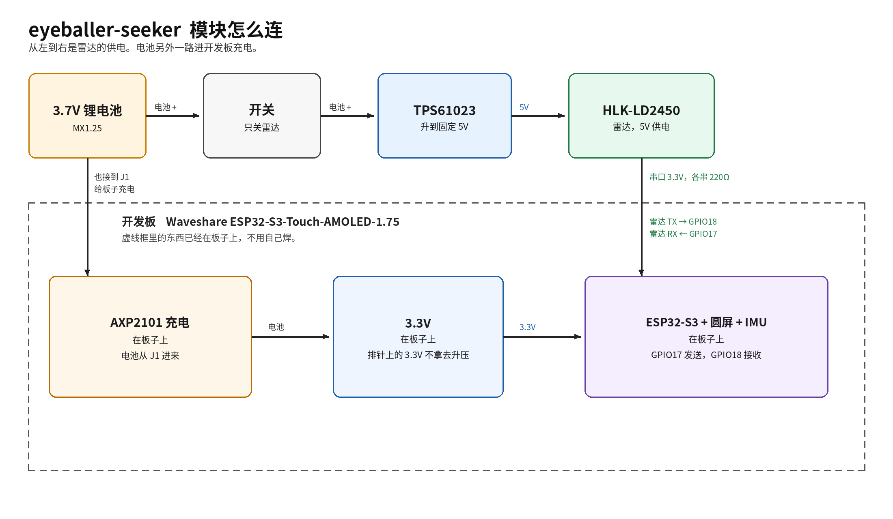

# eyeballer-seeker

手腕上的圆屏，眼睛跟着路过的人转。

A wrist-worn round display whose anime eyes follow people walking by.



坐在咖啡馆里，手平放，表盘朝外。屏幕上是一张二次元脸。有人从旁边走过，眼睛就锁住他；人走了，眼睛慢慢回到中间。从侧面看，也会觉得它在看你，这就是蒙娜丽莎效应。戴着它的人自己离得太近，不算目标。胳膊在动的时候，眼睛不追人，只是眨眨眼、随便看看。

第一版用现成的圆屏开发板和一颗 24 GHz 雷达。接线、转接板和组装前要量的地方在 [hardware/README.md](hardware/README.md)。原理图：[hardware/schematic.png](hardware/schematic.png)（[PDF](hardware/schematic.pdf)）。转接板：[顶层](hardware/pcb-top.png)、[底层](hardware/pcb-bottom.png)。

## 功能

- 1.75 英寸圆屏（466×466）上程序画的脸：眼白、虹膜、瞳孔、高光，会眨眼
- HLK-LD2450 最多报 3 个目标。0.5 m 以内的人丢掉，其余里面选一个跟着看
- 人离开后停大约 1.5 秒，再漂回画面中央，偶尔瞥一眼
- 板上的 QMI8658 判断手腕是否静止。在动就不跟人
- 没接雷达也能跑：默认用仿真目标，眼睛会左右扫
- 日志从 USB-C 出来，能看到每个目标和当前选中的是谁

脸的颜色和位置在 `firmware/main/face.h` 的 `k_face` 里，方便以后换成别的画法。

## 怎么工作

1. 雷达串口送出一帧坐标（仿真模式下由程序造同样的帧）。
2. 丢掉太近、太远和几乎在身后的点。已经锁定的人还在附近就继续跟；否则选最近的、正在移动的人。
3. 用 `atan2(x, y)` 得到左右角度，限制在大约 ±60°。人越远，瞳孔偏得越少。
4. 平滑之后画到圆屏上。手腕一动，眼睛改看中间。

阈值在 `firmware/main/config.h`。

## 硬件

买 **不带 GPS** 的 Waveshare ESP32-S3-Touch-AMOLED-1.75（标准版或 `-B`）。`-G` 的 GPIO17 / GPIO18 可能已经接到板上的 GPS，这两脚给雷达串口用。

价格是 2026 年 10 月公开页面上的大约数字，下单时以页面为准。

| 零件 | 作用 | 说明 |
| --- | --- | --- |
| [Waveshare ESP32-S3-Touch-AMOLED-1.75](https://www.waveshare.com/esp32-s3-touch-amoled-1.75.htm) | 圆屏、ESP32-S3、充电、IMU | 标准版或 `-B`。[Wiki](https://www.waveshare.com/wiki/ESP32-S3-Touch-AMOLED-1.75)。官网约 30–40 美元，国内常见大约 180–250 元 |
| [HLK-LD2450](https://www.hlktech.cn/Goods-352.html) | 24 GHz 雷达，最多 3 个目标 | 5V 供电，串口 3.3V。大约 30–40 元 |
| [TPS61023](https://www.ti.com/product/TPS61023) 固定 5V 模块 | 锂电池升到雷达要的 5V | 买焊好的固定 5V 模块，连续电流建议 ≥500 mA。大约 3–10 元 |
| 3.7V 锂电池，MX1.25 两针 | 插开发板电池座，并分一路给升压 | 1000–2000 mAh 大约 15–40 元 |
| 拨动开关 | 只关雷达 | 连续电流至少 0.5 A。大约 1–3 元 |
| 100nF ×2、22µF/10V、100µF/10V | 升压输入和雷达 5V 旁边 | 0805 / 1206 瓷片 |
| 220Ω ×2 | 串在 TX、RX 上 | 3.3V 串口，中间不加 5V 电平转换 |

升压并在电池正极上，不从开发板的 3.3V 或 USB 5V 取电。充电时关掉雷达开关。脚序、续航估算和转接板在 [hardware/README.md](hardware/README.md)。KiCad 7 或 8 打开 `hardware/eyeballer-seeker.kicad_pro`。旧版 Altium 打不开这些文件，看图用 PDF 和 PNG。

## 固件

ESP-IDF 工程，跑在 FreeRTOS 上。四个任务：

| 任务 | 做什么 |
| --- | --- |
| `radar` | 从 UART1 拼雷达帧，或在仿真模式下造帧 |
| `imu` | 读 QMI8658，判断手腕动不动 |
| `eye` | 选目标，平滑瞳孔，决定眨眼 |
| `disp` | 在 PSRAM 里画两张图，刷到 CO5300 圆屏上 |

雷达帧和眼睛状态各用一个队列，IMU 用互斥锁。屏驱动是 `espressif/esp_lcd_co5300`。安装、烧录和引脚出处在 [firmware/README.md](firmware/README.md)。

## 开始

先装 ESP-IDF v5.5.5（ESP32-S3），步骤在 [firmware/README.md](firmware/README.md)。然后：

```bash
cd firmware
idf.py set-target esp32s3
idf.py build
idf.py -p PORT flash monitor
```

`config.h` 里 `SIMULATE_RADAR` 默认是 1：不打开雷达串口，眼睛跟着一个假想的路人转。雷达接好后把它改成 0，再编译烧录。

第一次用 GitHub、只想看图：[docs/github-beginner.md](docs/github-beginner.md)。

## 目录

```text
.
├── firmware/          ESP-IDF 工程：任务、雷达解析、脸
│   ├── main/
│   ├── test/          电脑上的解析和选目标测试
│   └── README.md
├── hardware/          原理图、转接板、框图
│   └── README.md
├── docs/
│   └── github-beginner.md
├── LICENSE
└── README.md
```

## 路线

- **v1** 现成圆屏开发板加 HLK-LD2450，眼睛跟着雷达目标。转接板只负责电池、开关、5V 和串口。
- **v2** 加上摄像头，并把雷达和电源做到一块更薄的主板上。

## 许可

[MIT](LICENSE)。
