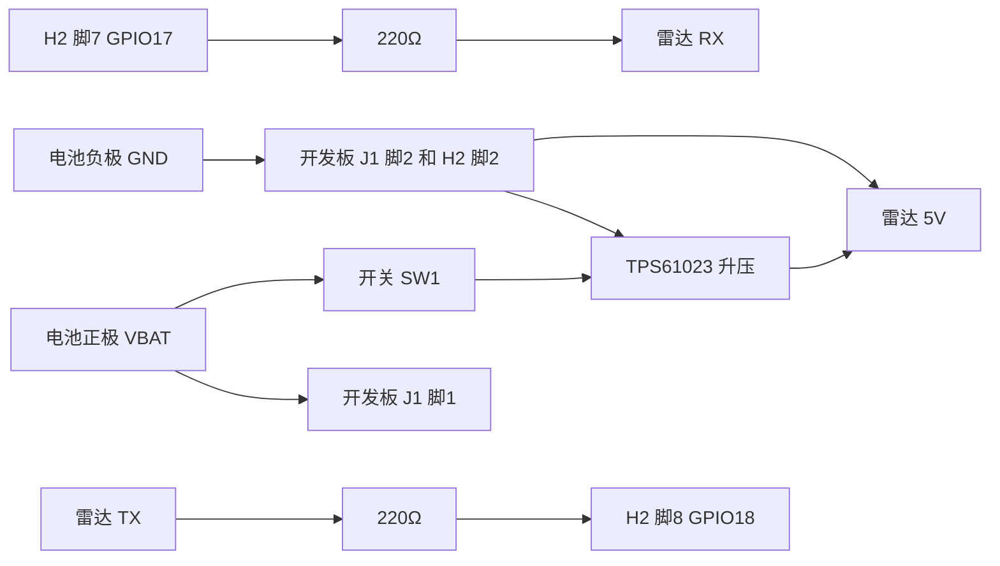

# 硬件

开发板、雷达、电池和 5V 升压怎么接。零件表在[仓库首页](../README.md#硬件)。

手机上放大看原理图：[schematic.png](schematic.png)（[PDF](schematic.pdf)）。转接板：[顶层](pcb-top.png)、[底层](pcb-bottom.png)。模块关系：[block-diagram.png](block-diagram.png)。

KiCad 工程：[eyeballer-seeker.kicad_pro](eyeballer-seeker.kicad_pro)（KiCad 7 或 8。原理图是 KiCad 7 的格式）。旧版 Altium 打不开这些文件，看图用 PDF 和 PNG。KiCad 8.0.9 下原理图 ERC 和 PCB DRC 都是 0。仓库里没有 Gerber、钻孔文件和贴片 BOM，打板前从 KiCad 自己导出。

官方原理图（本仓库的排针脚序以这份 PDF 为准）：

https://files.waveshare.com/wiki/ESP32-S3-Touch-AMOLED-1.75/ESP32-S3-Touch-AMOLED-1.75.pdf

官方硬件说明（排针脚 4–8 和上面那份 PDF 不一致，见下文）：

https://github.com/waveshareteam/ESP32-S3-Touch-AMOLED-1.75/blob/main/HARDWARE_REFERENCE.md

屏、触摸、IMU、充电芯片都在开发板里面。外面要接的是电池、只控制雷达的开关、5V 升压和雷达。

## 排针 H2（2.54 mm，8 脚）

脚序来自官方原理图 PDF（Altium，2025-07-28）里排针符号旁边的网名。

| H2 脚 | 网名 | 接到 |
| ---: | --- | --- |
| 1 | VBUS | 不接。这是 USB 的 5V，只有插着线才有 |
| 2 | GND | 地 |
| 3 | VCC3V3 | 不接。板内 DCDC1 的 3.3V，不拿去升 5V |
| 4 | U0TXD（UART0 TX，GPIO43） | 不接 |
| 5 | U0RXD（UART0 RX，GPIO44） | 不接 |
| 6 | GPIO16 | 空着 |
| 7 | GPIO17 | 板子发送，接到雷达 RX。固件里是 UART1 TX |
| 8 | GPIO18 | 板子接收，接到雷达 TX。固件里是 UART1 RX |

雷达两边都是 3.3V，中间只串 220Ω。所有 GPIO 都是 3.3V。

GitHub 上的 `HARDWARE_REFERENCE.md` 把脚 4–8 写成了 U0RXD、U0TXD、GPIO17、GPIO18、GPIO16。本仓库跟原理图 PDF 里的文字位置。两份都是官方材料。焊之前用万用表从芯片引脚量到排针，确认脚 7 是 GPIO17、脚 8 是 GPIO18。固件使用的是 GPIO 编号。

## 电池座 J1（MX1.25，两针）

在官方原理图的 POWER 区域。一个脚的网名是 `VBAT1`，另一个是 `GND`。

`VBAT1` 在电源树注释里写成 “CHG BAT”，并且和 AXP2101 的 BAT 脚（33）是同一个网。电池正极进充电芯片的电池脚。

本图把 **J1 脚 1 画成 VBAT1，脚 2 画成 GND**。PDF 里两个脚号靠得很近，红线以万用表为准：哪一脚和电池座正极、和 AXP2101 的 BAT 相通。

## 5V 从哪来

雷达要 5V，平均大约 120 mA，电源要能给出 200 mA 以上。电池大约 3.0–4.2V，所以要升压。

升压芯片用 TI TPS61023：输入大约 0.5–5.5V，启动大约 1.8V，开关电流能力 3.7A。数据手册里，3.6V 升到 5V、1.5A 时效率大约 94%；从输出端看，静态电流典型 20 µA。买已经焊成固定 5V 的模块。模块上如果 EN 已经和 VIN 连好，就保持那样。

可调的 MT3608 靠电位器定电压，拧过或漂移之后可能超过 5V。这里用固定 5V 的 TPS61023 模块。

| 板子上的电源 | 给升压模块吗 | 原因 |
| --- | --- | --- |
| J1 的 VBAT1 | 是 | 它就是电池正极，和 AXP2101 BAT 脚连在一起 |
| H2 脚 3 的 3.3V | 否 | 那是板内 3.3V 输出。再升到 5V 又亏电，也容易把板子拉垮 |
| H2 脚 1 的 VBUS | 否 | 只有插着 USB 才有 5V |
| AXP2101 的 VSYS（34 脚） | 没有插座 | 原理图上 DCDC5 标了 NC。排针和电池座都没有把 VSYS 引出来 |

升压并在电池上，不经过 AXP2101 的电流检测，所以：

- 屏幕上的电量百分比看不到雷达的耗电。
- 板子侧面的电源键关不掉雷达。雷达只听自己的开关。
- USB 仍然可以给同一颗电池充电。充电时如果升压还开着，充电电流会被雷达分掉。充电时把雷达开关关掉。

## 接线

| 从 | 到 | 说明 |
| --- | --- | --- |
| 电池 + | 开发板 J1 的 VBAT1，以及开关的一端 | 两路并在电池正极上 |
| 开关另一端 | 升压模块 VIN | 开关只在这一路 |
| 升压 EN | 升压 VIN | 模块如果已经连好，不用再焊 |
| 升压 VIN 对地 | C1 100nF、C2 22µF | 靠近模块输入 |
| 升压 GND、雷达 GND、电池 −、H2 脚 2、J1 的 GND | 连在一起 | 电池负极到 J1 是一根地线 |
| 升压 VOUT 5V | 雷达 5V | 靠近雷达放 C3 100µF 和 C4 100nF |
| 雷达 TX | 220Ω 再接到 H2 脚 8 GPIO18 | 雷达发送，板子接收 |
| 雷达 RX | 220Ω 再接到 H2 脚 7 GPIO17 | 板子发送，雷达接收 |
| 雷达 PA9 | 不接 | 有人/无人指示，固件不用 |
| H2 脚 1、3、4、5、6 | 不接 | 见上面的脚表 |

原理图按功能分成五块：电池和开关、电池座 J1、5V 升压、雷达、开发板排针 H2。同名电源连在一起：`VBAT`、`GND`、`+5V_RADAR`。`BOOST_IN`、`RADAR_TX`、`RADAR_RX` 也是同名相连。`RADAR_TX` 从雷达到 H2 脚 8，`RADAR_RX` 从 H2 脚 7 到雷达。

雷达串口是 256000 波特，8 数据位，无校验，1 停止位。电平 3.3V。供电是 5V。

## 转接板

[eyeballer-seeker.kicad_pcb](eyeballer-seeker.kicad_pcb)：40×36 mm 圆角矩形，两层，正反铺地。上面有电池座 J1、接到开发板电池座的 J2、开关 SW1、升压模块排针 J3、电容 C1–C4、雷达排针 J4、220Ω 的 R1 和 R2、接到 H2 的排针 J5。电源线 0.5 mm，信号线 0.25 mm。

按图纸装配时核对这几处：

- J1 按 JST GH 画，插头要能配开发板的 MX1.25 电池座。
- 升压脚序暂按 1 VIN、2 GND、3 EN、4 VOUT。
- 雷达脚序暂按 1 5V、2 GND、3 TX、4 RX。
- 开关中间脚当公共端。封装 JS102011 很多只有大约 0.3 A，这一路要能过 0.5 A。
- 22µF 用 0805、100µF 用 1206 瓷片（耐压 10V，容量会随电压下降）。

## 电从哪来，能用多久

下面是估算，不是这块板子测出来的。

雷达（海凌科手册）：5V，平均工作电流 120 mA，电源能力要大于 200 mA。

- 平均功率：5 V × 0.12 A = 0.60 W
- 升压按 90% 效率估算（数据手册在更重的负载上大约 94%）
- 从 3.7V 电池拿走的电流大约：0.60 ÷ 0.90 ÷ 3.7 ≈ 180 mA
- 电池快没电、按 3.3V 和 85% 效率：大约 210 mA
- 模块连续电流标到 500 mA 更稳妥

开发板加屏幕：官方原理图没有整机电流。按「Wi-Fi 关掉、脸大部分是黑的、芯片在跑」估 80–180 mA @ 3.3V，计算时取 120 mA。3.3 V × 0.12 A = 0.40 W。AXP2101 的 DCDC 按 90% 估算，折回 3.7V 电池大约 120 mA。

加在一起，典型估算大约 300 mA 从电池流出。

| 电池 | 估算时间 |
| --- | --- |
| 1000 mAh | 大约 3 小时 |
| 2000 mAh | 大约 6 小时 |

屏幕调亮、Wi-Fi 打开，或者升压效率更差，都会更短。电量图标也不包含雷达。

## 怎么摆

雷达和屏幕朝同一面，都朝路过的人。雷达水平视场大约 ±60°。天线前面不要挡金属。电池和升压放在屏幕背面或旁边。

雷达模块外形，手册表格写的是 15 mm × 44 mm。有的卖家写成 15 × 40 mm，以拿到的实物为准。

开发板是 1.75 英寸圆屏（466×466）。官方尺寸图：

https://www.waveshare.com/img/devkit/ESP32-S3-Touch-AMOLED-1.75/ESP32-S3-Touch-AMOLED-1.75-details-size.jpg

图上能读出的标注包括大约 48.96 mm、大约 44 mm 量级的屏区、安装孔 M2、排针间距 2.54 mm。整块板的长宽以这张图为准。

外壳比日常手表大。板子加上雷达、电池和升压，第一版是一个扁盒子，可以绑在手腕上，也可以放在桌上。厚度按「板子 + 排针 + 电池」先留大约 20 mm，等零件到了再量。

## 组装前量一下

图是按官方原理图 PDF、排针网名和芯片手册画的。装的时候对一下：

1. H2 脚 4 到脚 8 的顺序。原理图 PDF 和 `HARDWARE_REFERENCE.md` 不一致，以万用表为准。
2. J1 哪一脚是 VBAT1。确认后再定红线。
3. 升压模块在 200 mA 负载下是不是稳定的 5.0V，空载会不会冲高。
4. 开发板加这块屏幕、画一张暗的脸时，实际电流是多少。上面的续航会跟着改。
5. 雷达并在电池上之后，USB 充电是否还能把电池充进去。充电时先关雷达开关。
6. MX1.25 线上并接头是否牢固，会不会在手腕上扯松。
7. 串口线稍长时，256000 波特是否还干净。220Ω 是保护电阻。
8. 雷达天线朝外、和屏幕同一面时，0.5–3 米侧面走过的人是否还报得出来。官方没有给出角度精度。静止的人雷达也可能丢掉；这个场景主要看走路的人。
9. 屏幕上的脸、手腕静止判断、雷达帧解析。烧录和要看的日志在 [firmware/README.md](../firmware/README.md)。
